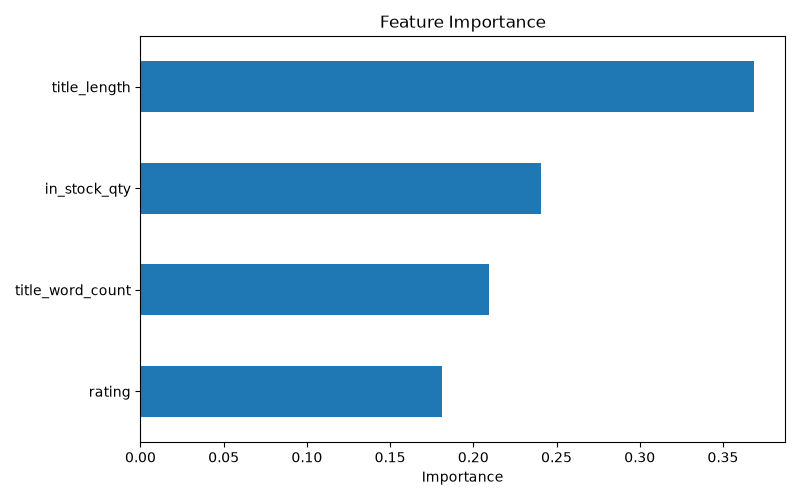
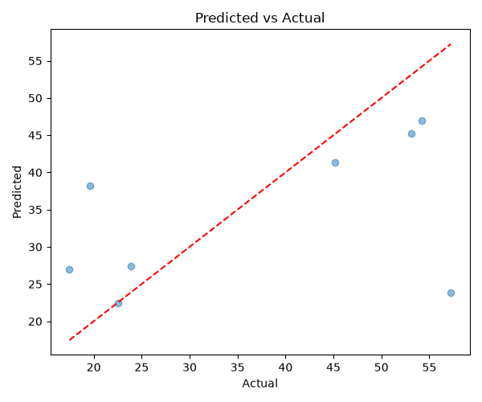

# Book Price Predictor ML Regression on Scraped E-Commerce Data

An end-to-end machine learning regression pipeline designed to predict book prices using features extracted from scraped e-commerce book catalog data.

## Project Overview
This project cleans raw web-scraped book data, engineers domain-specific text and numeric features, and evaluates multiple regression models to predict book prices accurately.

## Tech Stack
- **Language:** Python
- **Data Manipulation:** Pandas, NumPy
- **Machine Learning:** Scikit-learn
- **Visualization:** Matplotlib, Seaborn

## Reported Model Performance
- **Baseline Model (Linear Regression):**
  - **MAE:** 15.01
  - **R² Score:** 0.05
- **Advanced Model (Random Forest Regressor):**
  - **MAE:** 10.51
  - **R² Score:** 0.19

*Random Forest demonstrated a significant performance improvement over the Linear Regression baseline.*

## Generated Visualizations



## How to Run
1. Clone the repository and navigate into the project folder.
2. Create and activate a virtual environment:
   ```bash
   python -m venv venv
   .\venv\Scripts\Activate.ps1